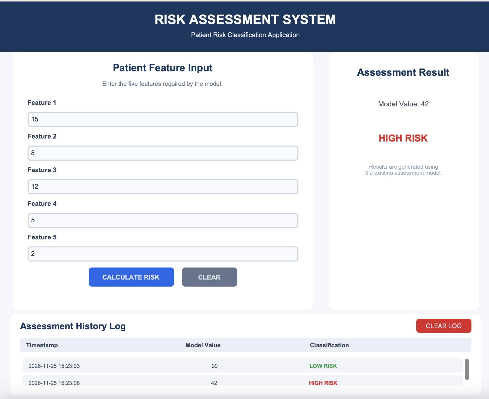
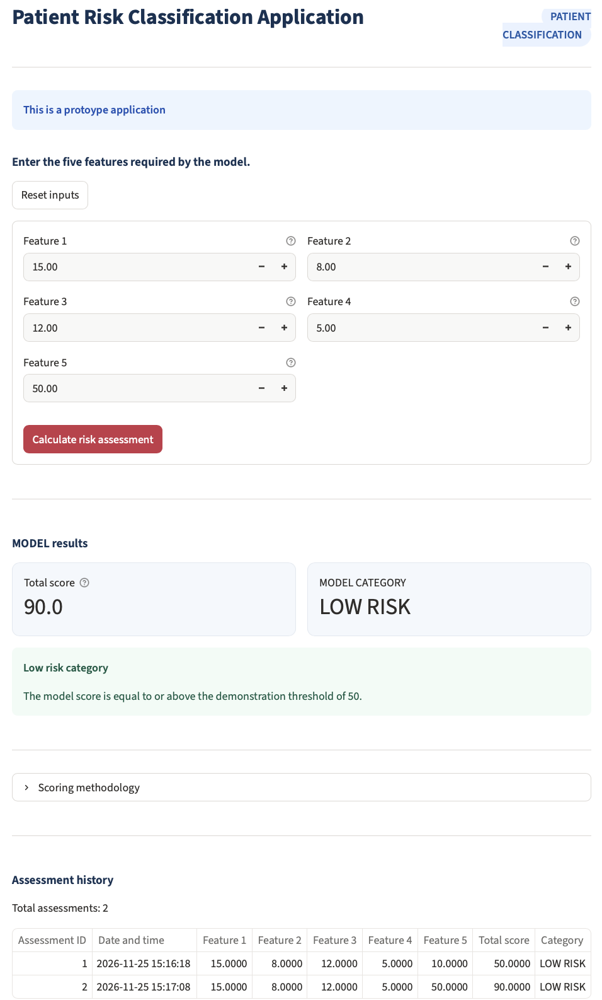

# Research Risk Assessment

A Python-based research prototype demonstrating a shared risk-scoring engine with desktop and web interfaces.

## Overview

Research Risk Assessment is a protoype application that accepts five numerical feature values and assigns a risk category using a predefined threshold.

The project demonstrates Python application development, input validation, reusable code, automated testing, and CI/CD using GitHub Actions.

## Features

- Shared scoring engine used by both interfaces.
- Input validation for five finite, non-negative numerical values.
- Desktop application built with CustomTkinter.
- Web application built with Streamlit.
- Assessment history with timestamps.
- CSV export of web assessment history.
- Unit testing and automated code-quality checks.
- GitHub Actions workflows for packaging and Windows executable builds.

## Application Screenshots

### Desktop Application



### Web Application



## Scoring Methodology

The application accepts five numerical features and calculates their sum:

The prototype classification rule is:

| Condition | Classification |
|---|---|
| Total score below 50 | HIGH RISK |
| Total score of 50 or above | LOW RISK |

The scoring logic is implemented in `app.py` and shared by both interfaces.

## Technology Stack

- Python
- CustomTkinter
- Streamlit
- pandas
- unittest
- Ruff
- GitHub Actions

## Installation

Clone the repository:

```bash
git clone https://github.com/kashupp/risk-assessment-app.git
cd risk-assessment-app
```

Create and activate a virtual environment:

```bash
python3 -m venv .venv
source .venv/bin/activate
```

Install dependencies:

```bash
python -m pip install --upgrade pip
python -m pip install -r requirements.txt
```

## Running the Applications

### Desktop application

```bash
python gui.py
```

### Web application

```bash
streamlit run streamlit_app.py
```

Streamlit will provide a local URL in the terminal. Open it in a web browser.

## Testing

Run the unit tests:

```bash
python -m unittest discover -v
```

Run the code-quality checks:

```bash
python -m pip install ruff
python -m ruff check .
```

Check Python syntax:

```bash
python -m compileall -q app.py gui.py streamlit_app.py test_app.py
```

## Continuous Integration and Delivery

GitHub Actions automates:

- Ruff code-quality checks.
- Python syntax compilation.
- Unit tests.
- Application packaging on pushes to `main`.
- Windows executable builds on selected branches and version tags.
- GitHub releases when version tags are pushed.

## Project Structure

```text
risk-assessment-app/
│
├── app.py
├── gui.py
├── streamlit_app.py
├── test_app.py
├── requirements.txt
├── README.md
│
├── docs/
│   ├── architecture.md
│   ├── usage.md
│   └── testing-and-ci.md
│
└── .github/
    └── workflows/
        └── python-ci-cd.yml
```

## Limitations

- The scoring rule and threshold are illustrative.
- The web application's assessment history is session-based.

